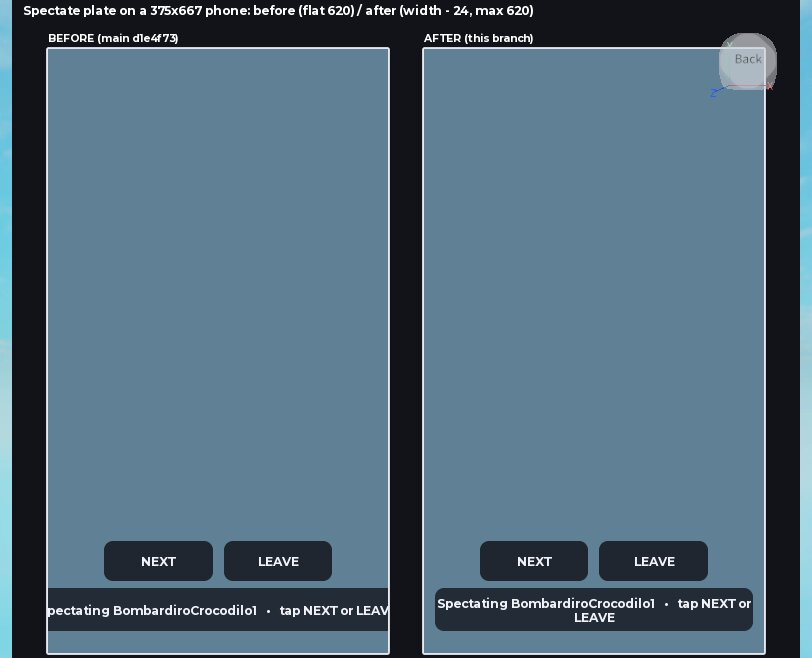
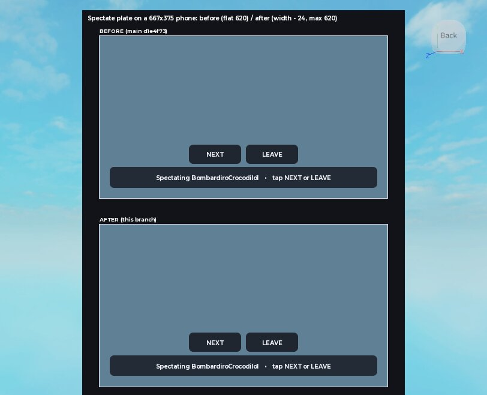
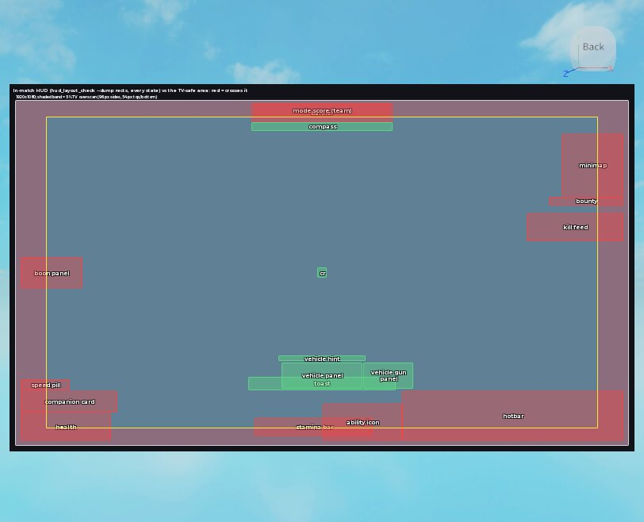
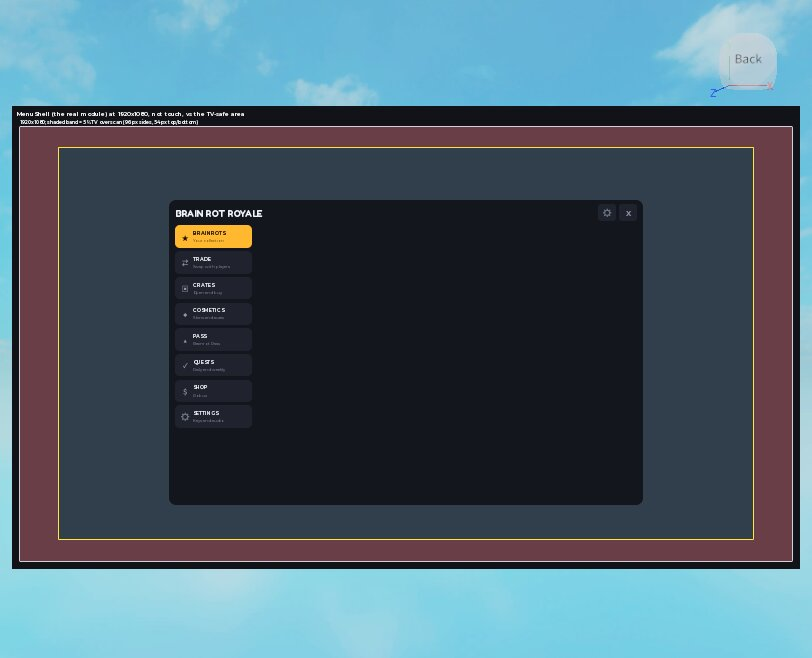

# task/device-compat

The phone and Xbox compatibility pass (coordinator handoff, item 4). Cut from main `d1e4f73`.

Every player action was traced from its binding in the source to its keyboard, touch and gamepad path.
The clear gaps are fixed below, and a check keeps the table true. The product and layout questions are
not guessed at. They are listed under "Open, for Oliver" and printed as `OPEN` on every run.

## What changed and why

- `ServerScriptService/Modules/ZiplineService.lua`: the zipline's "Ride" prompt is on pad **B**.
  Roblox's default is X, and X is Reload in a match, so a pad player reloading within 12 studs of a
  handle also rode the line. It's the same bug (#86) that LootService fixed for floor guns.
- `ServerScriptService/Modules/LobbyService.lua`: the range podium's "Take" prompt is on pad **B** for the
  same reason. Reload is live on the range (`inCombat` counts `rangeActive`), so reloading a range gun
  next to a podium took that podium's gun.
- `StarterPlayerScripts/MenuShell.lua`: a gamepad gets a starting selection when the menu opens (the
  active destination's cell). It keeps a selection after changing tabs, which rebuilds every cell and
  used to destroy the one the pad was on. It hands the pad back when the menu closes. Before this, a pad
  could open the menu (Back) but had nothing selected to move from, and B closed it again.
- `StarterPlayerScripts/VoteScreen.lua`: the vote redraws every second (the countdown) and on every vote,
  which destroyed the card a pad had selected. The selection is now carried across redraws by candidate
  id and cleared when the vote hides. The screen does **not** take a selection on the player's behalf:
  that would take the left stick and A away from walking in the lobby (open question 2).
- `StarterPlayerScripts/MergeDialog.lua`: on a pad the dialog opens with CANCEL selected, so a stray A
  never spends anything. It hands the selection back to the MERGE button it came from when it closes.
- `StarterPlayerScripts/CombatClient.client.lua`: the spectate plate was a flat 620 px, which ran 122 px
  off each side of a 375 px upright phone. It is now the screen width less 12 px a side, capped at 620.
  No new top-level local: it's inside `setSpectating`.
- `tools/device_compat_check.py` (new): the check, below.
- `tools/device_compat_gallery.lua` (new): the renders below. No game code; it copies the spectate
  plate out of CombatClient and draws `hud_layout_check --dump`'s 1920x1080 rects.

## The check

`python tools/device_compat_check.py .` (`--table` prints the table, `--plant` runs the planted faults).
It reads the source; no lupa or Studio needed. It reuses keybind_check's Settings reader.

- **B**: every Settings.Bind / BindAction[AtPriority] site found (25 bindings) is claimed by an action.
- **A**: all 36 actions have a path on each of the 3 devices, whether a binding key, a source anchor, a
  Roblox default, a written waiver, or `OPEN`.
- **S**: every Settings action row is bound somewhere.
- **R**: raw input sites (InputBegan, JumpRequest, IsKeyDown...) are counted per file (29); a new one fails.
- **P**: no ProximityPrompt's pad key is live gameplay where the prompt stands (13 prompts).
- **C**: ContextActionService's 7-button touch cap. The 7 permanent buttons fill it, so the 6 bound
  later are `OPEN` (below), and any new one fails.
- **G**: modal screens hand a pad a selection.

Measured: main `d1e4f73` gives **problems: 5**, the zipline and podium prompts plus menu, merge dialog
and vote pad entry. This branch gives **problems: 0**, and **9/9** planted faults are caught.

## Open, for Oliver

1. **Phone touch buttons past the cap (biggest).** The CoreScript (`ContextActionTouch.lua`) draws at
   most 7 CAS touch buttons, and a slot frees only on unbind. CombatClient and MovementClient bind 7 at
   load and never unbind them, so these never get a proper button on a phone: vehicle BRAKE, the vehicle
   gun's FIRE and AIM, the mounted gun's RELOAD and LEAVE, and COOK. With the engine flag off, the 8th
   button is created blank at its default spot and is not removed on unbind. With it on, it is not
   created at all. A phone gunner cannot fire a mounted gun. `mounted_guns_check`'s I2 lays out positions
   for buttons that are never drawn. The fix is `TouchControls.Enabled` (built for this, flag off pending
   its playtest) plus moving these six into it, or unbinding the on-foot buttons while seated. Which?
2. **Vote on a pad.** A pad votes by selecting a card and pressing A, but nothing selects one. Should
   the vote take the stick and A while it's up (the player can't walk meanwhile), or get its own buttons?
3. **Drop spot on a pad.** The map takes mouse or touch only, so a pad always drops at random. Should it
   get a stick cursor (`GamepadService:EnableGamepadCursor`), or is random fine?
4. **Settings sliders on a pad.** A pad can reach Settings but can't move volume, FOV or sensitivity.
   Is a fix wanted, after a Studio test of d-pad input on a selected track?
5. **TV-safe margin on Xbox.** Roblox leaves overscan to the game (console guidelines), and nothing here
   insets for it. `hud_layout_check --dump` at 1920x1080 puts the health bar, companion card, speed pill
   and boon panel 16 px from the left. The hotbar, minimap, bounty line and kill feed sit 16 px from the
   right, the health bar, hotbar and ability icon 16 px from the bottom, and the banner and mode score
   10 px from the top. A 5% TV margin is 96 px on the sides and 54 px top and bottom. Add a console-only
   inset (in PhoneLayout/UiKit, when `GuiService:IsTenFootInterface()`), or leave it?
   The render (Renders, above) shows these 12 crossing it: banner and team mode score (44 px past the
   top), health (80 left, 38 bottom), companion card, speed pill and boon panel (80 left), stamina bar
   (24 bottom), hotbar (80 right, 38 bottom), minimap, bounty and kill feed (80 right), ability icon
   (38 bottom). Inside it: compass, crosshair, toast, and the vehicle and vehicle-gun panels. The menu
   is inside.

## Renders

`tools/device_compat_gallery.lua`, one Linux-harness run in edit mode. The numbers come from the
gallery's `note` lines, not from reading the picture.

375x667 upright. Before: the 620 px plate runs 122 px off each side and the text is cut at both ends.
After: the plate is 351 px wide, and the longest touch text (a 20-character name) wraps to 2 lines,
32 px tall inside the 48 px plate. NEXT and LEAVE (252 px across) fit above it.

667x375. 620 already fit, so before and after are the same: one line, no change on wider screens.

The HUD at 1920x1080 with the 5% band shaded. 12 of 18 elements cross it (red), listed under open
question 5 below.

The real MenuShell at 1920x1080. The panel (369,181, 1180x760) and every piece in it sit inside the
safe area.

## Not proven (needs Studio or a real device)

- That the pad selection lands and moves as intended, in the menu, vote, merge dialog and on tab
  change. The logic is here, but no probe can synthesise input.
- Whether ButtonSelect (bound to the menu, handler returns Pass) also toggles Roblox's own UI selection
  mode. The docs don't say.
- The CAS cap in the emulator: bind a vehicle gun on a phone emulator and count the buttons drawn.
  Edit mode can't show this. The touch buttons are drawn by a CoreScript that only runs on a touch
  client, and a probe calling `GetAllBoundActionInfo` would only read back its own binds. From the
  source, the buttons asked for are 7 on foot (8 holding a throwable: COOK), 8 in a driver's seat
  (BRAKE, 9 with FIRE on an armed car), and 11 on a mounted gun (FIRE, AIM, RELOAD, LEAVE). At most 7 get drawn.
- The spectate plate is rendered (above), but only from a copy of its code in the gallery, not in a
  live client.
- TV-safe area on Xbox: the render above takes its rects from the mocked HUD (`--dump`). Whether a real
  TV crops them needs a console.
