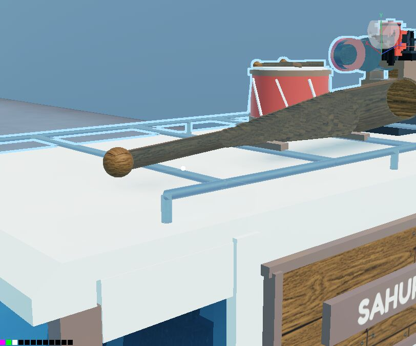

# task/vehicle-seams

Cut from main `d1e4f73` (after the 9c44f4b revert of the vehicle WIP; none of 14eebfd's files are
touched). Item 1 "Seams" of the coordinator's handoff
(`coordination/messages/2026-09-25-0830-coordinator-handoff-remaining-to-jacob.md`).

The SahurVan bat was a handle, four stepped pieces and a barrel, and every joint showed a ring
(radius steps of 0.06-0.08) that read as see-through. Roblox has no cone, so a taper has to be a
stack of cylinders. What changes is the step size: small enough that no joint shows.

- `ReplicatedStorage/Shared/VehicleModels.lua`: new `Builder:taper(name, a, b, d0, d1, role, anchor)`
  cuts a widening run into equal radius steps of at most `TAPER_STEP` (0.015), counting both ends as
  joints. The bat's handle now widens into its barrel through it: `BatTaper1..22`, replacing
  `BatFlare`, `BatTaper`, `BatThroat`, `BatShoulder`. Handle, barrel, knob, end cap, rake and rack
  rest are unchanged; the straps read the taper's radius from the helper. The bat is visual only
  (no collision, massless, not queryable), so no physics changes. SahurVan parts go from 433 to 451
  (drive) and 230 to 248 (parked).
- `tools/vehicle_models_axis_check.py`: invariant 7, seams. Across every model, scheme and build it
  finds runs of three or more same-look coaxial cylinders meeting end to end and widening one way,
  and fails any joint that steps the radius by more than 0.02 or opens a gap. It also prints how many
  cylinders it examined. A part wrapped round a joint (a bearing race) ends the run there. Three new
  planted faults: `TAPER_STEP` at 0.07, taper pieces cut short, and a stepped three-piece tube on the
  Ranger. The bat invariant now reads its chain as handle, `BatTaper1..N`, barrel, and the old plants
  point at the new piece names.

Measured by the new invariant (all 9 models, every scheme, drive/parked/unarmed):

| tree | taper joints | stepped over 0.02 | widest step |
| --- | --- | --- | --- |
| main `d1e4f73` | 75 | 75 | 0.080 |
| this branch | 345 | 0 | 0.015 |

## Render

`tools/vehicle_gallery.lua` limited to `closeup_bat_SahurVan` (a temp copy with
`SHOW_OVERRIDE = { "SahurVan" }` and `VIEW_KINDS_OVERRIDE = { "closeup_bat_SahurVan" }` glued in
front), run on the Linux harness against each tree's own build. Same camera in both.

Main `d1e4f73`: the handle widens into the barrel in four visible steps, each a lip with a ring
round it.

This branch: one continuous flare from handle to barrel with no ring or gap. Up close the handle to
`BatTaper1` joint shows a faint shoulder (that first step is 0.015), and the grain shows fine
striations along the taper. There is no see-through gap. Straps and barrel look the same as on main.
