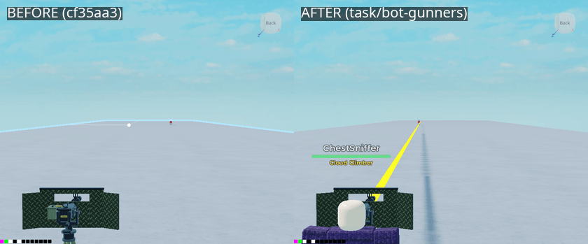
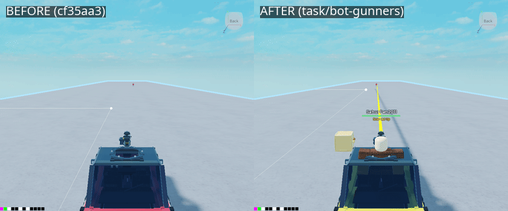
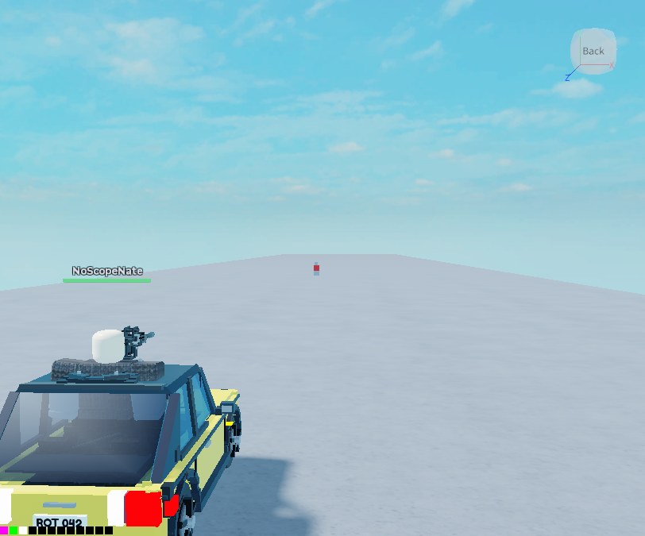
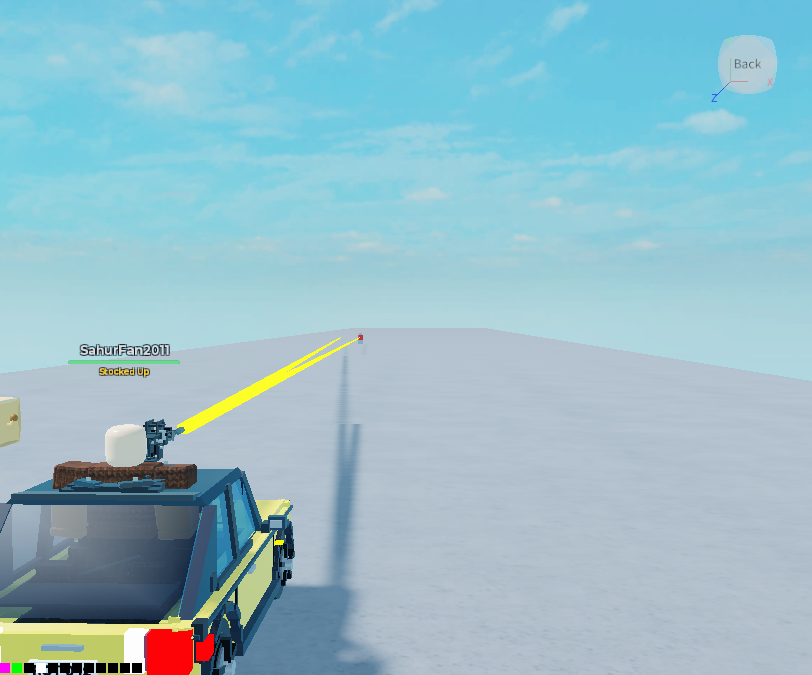
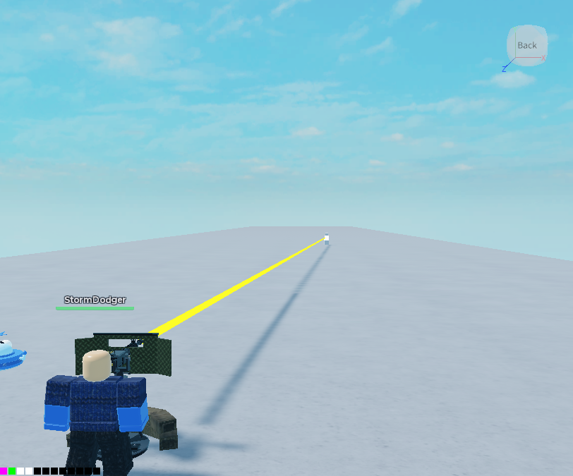
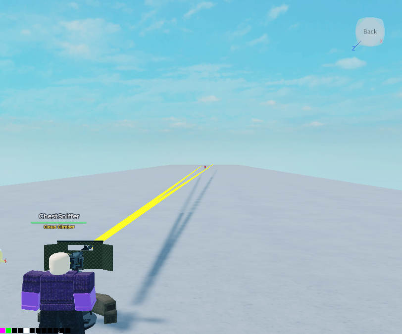

# proof/bot-gunners: pictures for PR "Task 20: bot gunners engage better (on pc/lag-bug-sweep)"

**Never merge this branch.** It holds only the proof images for the PR, so the task branch commits no images.

All frames come from `tools/bot_gunner_probe.lua` under the Linux Studio harness (`tools/linux/studio.py gallery`),
in Run mode, on builds of cf35aa3 (before, the tip of `pc/lag-bug-sweep`) and `task/bot-gunners` (after). A bot
gets on the gun by itself; a stand-in target runs across the gun's line at 16 studs/s and turns back every 4 s.
No client runs in Run mode, so the game's own tracers and the turret's swing (both drawn by clients) never show.
**The yellow lines are the probe's own drawing**: one per shot, from the muzzle to where that shot was aimed (a
rolled miss is aimed off to the side). The target's torso flashes white on a hit. The thin white line with a
dot, in some frames, is not from the probe and not a shot; I didn't identify it.

## gunner_hmg_400_before_after.gif

A Rattlefang HMG emplacement (reach 450), the runner 400 studs down its line. **Look for:** left (before), the gun
stands empty: the bot got on, never saw the runner past the bots' 260-stud vision, and got off ("gun idle").
Right (after): the bot fires at the runner in bursts. A shot line shows in 16 of the 36 frames after and in 0 of 36
before (counted from the frames' pixels).

## gunner_car_300_before_after.gif

A parked Rotster's roof gun (reach 320), the runner 300 studs out. **Look for:** left, the bot sits on the gun and
never fires (it never picks the runner); right, it fires bursts down the line. A shot line in 20 of 36 frames after,
0 of 36 before.

## Stills (after), the camera behind each gun

| | |
|---|---|
|  Rotster roof gun, runner at 200 |  Rotster roof gun, runner at 300 |
|  HMG emplacement, runner at 200 |  HMG emplacement, runner at 400 |
